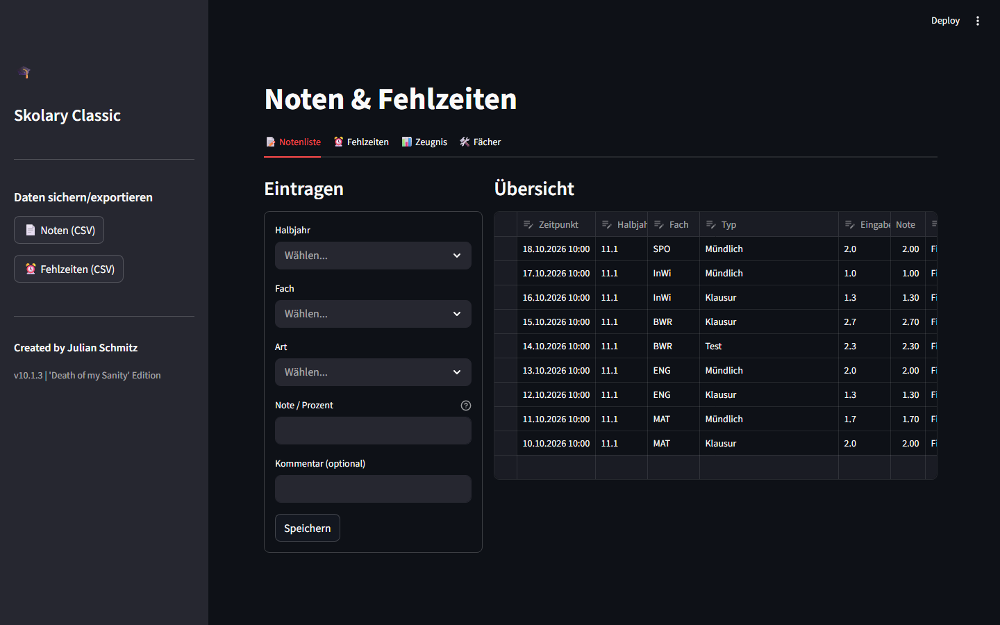
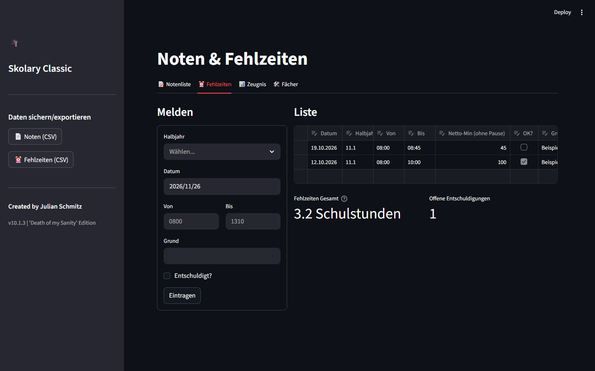
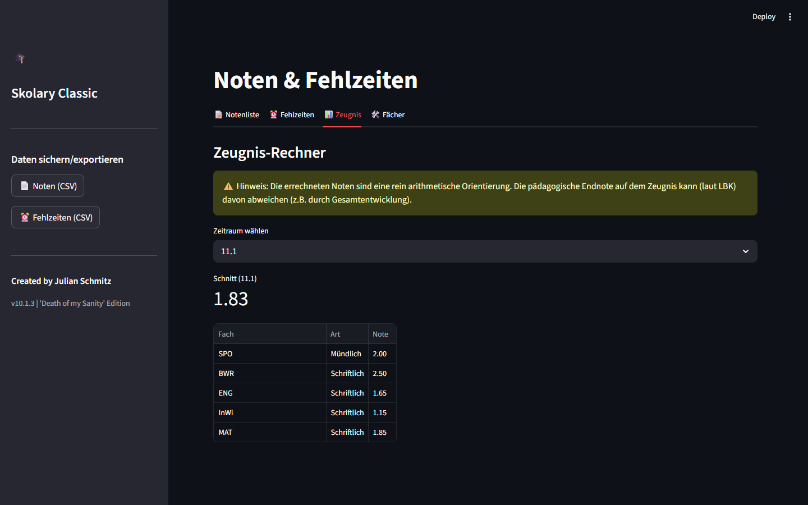

# Skolary Classic by JStudios

[-7656b5.svg)](https://jstudios.pages.dev/projects/skolary-classic/)
[](https://www.python.org/)
[](https://streamlit.io/)
[](https://jstudios.pages.dev/projects/skolary-classic/)
[](https://jstudios.pages.dev/projects/skolary-classic/)
[](LICENSE)

**Der ursprüngliche Vorläufer von Skolary.**

[Projektseite](https://jstudios.pages.dev/projects/skolary-classic/) · [Lizenz](LICENSE) · v10.1.3 · historischer Vorläufer

Noten, Fehlzeiten, Fächer und rechnerische Zeugnisübersichten in einer lokalen Browseranwendung. Skolary Classic dokumentiert die frühere Entwicklungsstufe vor dem aktuellen Flutter-Projekt.

## Hintergrund

Vor dem aktuellen Skolary gab es eine Python-Anwendung für meine persönliche Schulorganisation. Das Grundkonzept war bereits dasselbe: Leistungsdaten übersichtlich erfassen, Unterrichtsfehlzeiten minutengenau berechnen und den aktuellen Notenstand nachvollziehbar darstellen. Dieser historische Stand bleibt als eigenständiges Source-Available-Projekt verfügbar.

## Vorschau

### Notenliste



*Erfassung und bearbeitbare Übersicht mit fiktiven Leistungen.*

## Funktionsumfang

### Noten und Prozentwerte

Noten mit Tendenz (z. B. 2+) oder Prozentwerte eingeben. Ein festes Umrechnungsschema wandelt Prozentwerte in Notenwerte um. Einträge lassen sich in der Tabelle bearbeiten.

### Minutengenaue Fehlzeiten

Start- und Endzeit erfassen. Hinterlegte Pausen werden anhand der zeitlichen Überschneidung abgezogen; die Übersicht zeigt Schulstunden und offene Entschuldigungen.

### Zeugnis-Rechner

Schriftliche und sonstige Leistungen werden bei schriftlichen Fächern zu gleichen Teilen gewichtet, sofern beide Gruppen vorhanden sind. Eine fest eingetragene Zeugnisnote hat Vorrang.

### Fächer verwalten

Standardfächer und zusätzliche Fächer bearbeiten. Beim Löschen eines Fachs werden auch zugehörige Noten gelöscht; vorher sichern.

## Beispiel und Bedienung

In der fiktiven Vorschau ergeben neun Noteneinträge aus fünf Fächern den rechnerischen Schnitt 1,83. Zwei Fehlzeiten ergeben 145 Netto-Minuten beziehungsweise rund 3,2 Schulstunden. Bei einem Beispiel von 08:00 bis 10:00 werden 20 Minuten Pause abgezogen: 100 Netto-Minuten.

1. **Halbjahr und Fach auswählen:** Leistungsart, Note oder Prozentwert sowie optional einen Kommentar erfassen.
2. **Anwesenheit dokumentieren:** Datum, Unterrichtszeit und Entschuldigungsstatus erfassen.
3. **Zeugnisstand prüfen:** Rechnerischen Zwischenstand pro Fach und Halbjahr anzeigen und CSV-Dateien sichern.

### Fehlzeiten



*Beispielzeiten mit Pausenabzug und Entschuldigungsstatus.*

### Zeugnis-Rechner



*Arithmetische Orientierung anhand der fiktiven Noten.*

## Technische Eckdaten

Python · Streamlit · pandas · CSV

| Bereich | Beschreibung |
| --- | --- |
| Notenspeicher | daten_noten.csv |
| Fehlzeitenspeicher | daten_fehlzeiten.csv |
| Halbjahre | 11.1 bis 13.2 |
| Schulstunden | Netto-Minuten geteilt durch 45 |
| Version | 10.1.3, historischer Stand |

## Installation unter Windows

Python und pip installieren.

```powershell
git clone https://github.com/byJStudios/skolary-classic.git
cd skolary-classic
python -m venv .venv
.venv\Scripts\python.exe -m pip install -r requirements.txt
.venv\Scripts\python.exe -m streamlit run app.py --server.address 127.0.0.1
```

Alternativ das Repository als ZIP herunterladen und entpacken. Die lokale Browseradresse wird von Streamlit im Terminal angezeigt. Keine realen Daten in den Repository-Ordner einchecken.

## Projektstatus, Datenschutz und Grenzen

Rechnerische Orientierung, keine verbindliche Zeugnisnote und keine offizielle Schulsoftware. Pausen, Umrechnungsskala und Fachkonfiguration sind auf das historische Modell zugeschnitten. Die CSV-Dateien entstehen lokal; keine echten Schülerdaten im Repository. Nicht mit dem aktuellen privaten Skolary verwechseln.

## Lizenz

Eigener Quellcode unter der [PolyForm Noncommercial License 1.0.0](LICENSE) (Source-Available, keine OSI-Open-Source-Lizenz). Frühere Veröffentlichungen werden nicht mehr angeboten; bereits wirksam erteilte Rechte bleiben unberührt. Drittkomponenten behalten ihre jeweiligen Lizenzen (Streamlit: Apache-2.0; pandas: BSD-3-Clause). JStudios behält sich vor, Nutzungen außerhalb der geltenden Lizenz und gesetzlicher Erlaubnisse rechtlich zu verfolgen. Gesonderte kommerzielle Nutzungsrechte: [jstudios.development@gmail.com](mailto:jstudios.development@gmail.com).

© 2026 Julian Schmitz / JStudios
